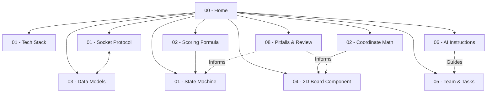

# 🧭 00 - Map of Content (Home)

This note is the central index for Obsidian Graph View and internal navigation.

## System Architecture
* [[01 - System Architecture/Tech Stack|Tech Stack & Libraries]]
* [[01 - System Architecture/Socket Protocol & Events|Real-time Socket Protocol]]
* [[01 - System Architecture/State Machine & Game Loop|Game State Machine & Lifecycle]]

## Game Mechanics & Design
* [[02 - Game Mechanics/Coordinate System & Math|Coordinate System & Math Transformations]]
* [[02 - Game Mechanics/Scoring Formula & Balance|Scoring Calculation & Balancing]]
* [[02 - Game Mechanics/Edge Cases & Disconnects|Disconnections, AFK & Fallbacks]]

## Schemas & Code Contracts
* [[03 - Data Models & Schemas/Data Models (TypeScript)|Core TypeScript Interfaces]]
* [[03 - Data Models & Schemas/Content Deck Schema|Topic & Axis Deck Schema]]

## UI & Visual Design
* [[04 - Modules & UI/2D Coordinate Board Component|2D Interactive Board Component (SVG)]]
* [[04 - Modules & UI/Screens & Role Views|Screen Layouts: Psychic vs Guesser vs Reveal]]

## Project Execution & Guidelines
* [[05 - Team & Roadmap/Team Ownership & Tasks|Team Division of Labor (4 Members)]]
* [[05 - Team & Roadmap/Sprint Roadmap|Milestones & Sprint Plan]]
* [[06 - AI Guidelines/AI Agent Instructions & Contract|AI Agent Coding Contract (CRITICAL)]]
* [[07 - Content Bank/Starter Topics & Word Pairs|Starter Deck (Ready-to-use JSON)]]
* [[08 - Pitfalls & Open Decisions/Potential Problems & Critical Review|Potential Problems & Critical Review]]
