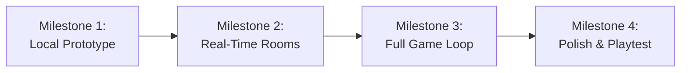

# 05 - Sprint Roadmap

This roadmap breaks down development into 4 manageable milestones designed for vibecoding workflows.

---

---

## 🏁 Milestone 1: The Local Toy (Day 1)
* **Goal:** A single-player test bench in React where you can drop a pin on a coordinate plane and see a score.
* **Deliverables:**
  * Interactive SVG square with X and Y axes.
  * Click to drop a pin.
  * "Reveal" button that shows a hardcoded target point and calculates distance.
  * Validates math formulas before introducing networking.

## 🏁 Milestone 2: Networking & Room Creation (Day 2)
* **Goal:** Two browser windows can connect to the same 4-letter room code.
* **Deliverables:**
  * Node.js + Socket.io server running.
  * Host creates room; friend joins with 4-letter code.
  * Player list updates in real-time.
  * Host starts game; server designates one player as Psychic.

## 🏁 Milestone 3: The Full Round Loop (Day 3)
* **Goal:** Complete a full round from clue to reveal and score calculation.
* **Deliverables:**
  * Psychic receives secret coordinate and types clue.
  * Guessers see clue and place their pins.
  * Guessers lock in.
  * Server calculates scores and broadcasts reveal.
  * Points update on leaderboard.

## 🏁 Milestone 4: Polish, Mobile Testing & Juice (Day 4)
* **Goal:** Make the game fun, responsive, and ready for friends to play.
* **Deliverables:**
  * Audio sound effects and confetti.
  * Responsive mobile UI testing on phones (using local network or ngrok).
  * Expanded deck with 50+ topics and axes pairs.
  * Host migration / disconnect safety.
