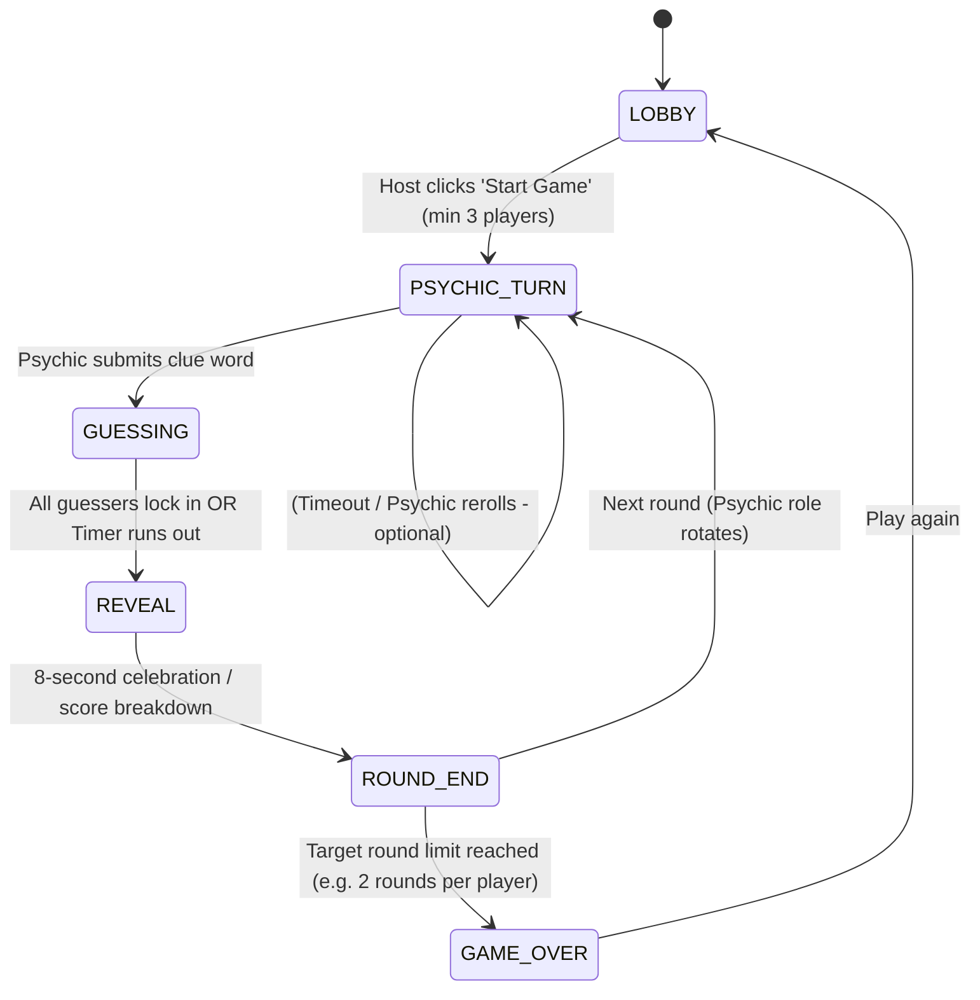

# 01 - State Machine & Game Loop

This document outlines the authoritative server game loop and client phase rendering.

---

## 🔄 State Machine Flowchart

---

## ⏱️ Phase Breakdown

### 1. `LOBBY`
* **Trigger:** Room creation.
* **Actions:** Players join via 4-character code; set display names.
* **Transition:** Host presses "Start Game" (requires at least 3 connected players).

### 2. `PSYCHIC_TURN`
* **Server Action:**
  * Selects next psychic in round-robin order.
  * Picks 1 random Topic and 2 random pairs of opposing attributes from deck.
  * Initializes `rerollsRemaining = 1`.
  * Generates random target point:
    $$x_s \in [-0.85, 0.85], \quad y_s \in [-0.85, 0.85]$$
    *(kept slightly inside borders so targets are never on the absolute pixel boundary)*.
  * Emits `psychic:secret_data` **only to the psychic**.
* **Client Action:**
  * **Psychic:**
    * Sees target point on the board, topic, and axes.
    * **Reroll Button:** Has a 1-time "Reroll" button per turn to request a fresh topic, axes, and target if the combination is impossible.
    * Enters a clue following [[02 - Game Mechanics/Clue & Word Selection Rules|Clue & Word Selection Rules]] and hits "Send Clue".
  * **Guessers:** See "Psychic is thinking of a clue..." with a fun waiting spinner.
* **Transition:** Server receives `psychic:submit_clue`.

### 3. `GUESSING`
* **Server Action:**
  * Starts countdown timer (e.g. 60–90 seconds).
  * Broadcasts `clue`, `topic`, `axisX`, and `axisY` to all players.
* **Client Action:**
  * **Psychic:** Spectator view ("Waiting for other players to guess").
  * **Guessers:** Can tap/drag on the 2D plane to place their pin. Once satisfied, click "Lock In Guess".
* **Transition:** Automatically triggers when **all non-psychic players have locked in**, or the timer hits 0.

### 4. `REVEAL`
* **Server Action:**
  * Computes Euclidean distance for all locked guesses.
  * Calculates points for guessers and psychic.
  * Broadcasts `game:reveal` containing target point and all player coordinates.
* **Client Action:**
  * Secret point animates onto the screen with pulsing target rings.
  * All player pins drop onto the board with their player names and points earned.
  * Sound effect: Fanfare / Ding / Buzzer.
* **Transition:** After 8–10 seconds, transitions to `ROUND_END`.

### 5. `ROUND_END` & `GAME_OVER`
* Displays current leaderboard.
* If all players have had $N$ turns as psychic (default: 1 or 2 turns each), transitions to `GAME_OVER` (podium screen).
* Otherwise, advances to `PSYCHIC_TURN` with the next player.
